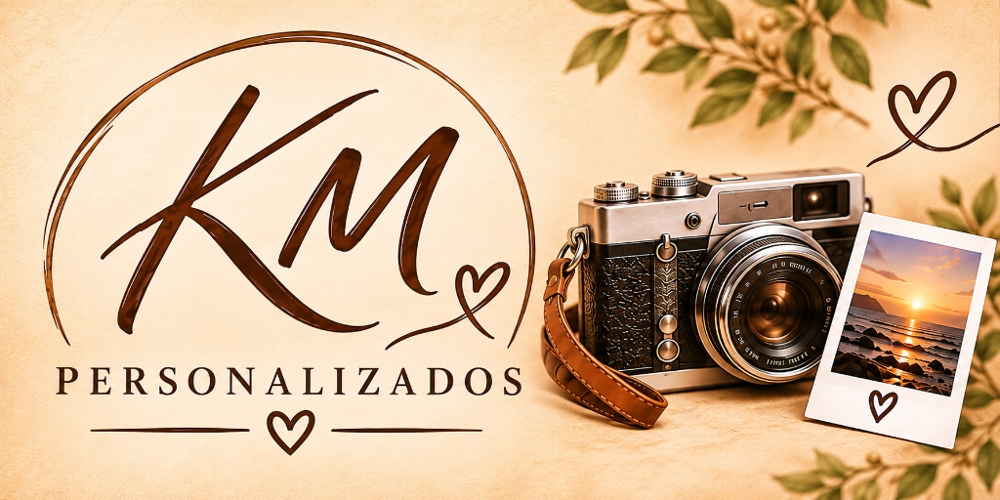

# KM Personalizados - Loja Oficial & Estúdio Web-to-Print 🇵🇹

Site oficial e ateliê digital da **KM Personalizados** em Portugal, especializado em **Bótons Ímãs Quadrados de Fotos** (6,1 x 6,1 cm) com acabamento premium e tecnologia exclusiva de fundo borrado para prensa manual.



## 🌟 Novidades & Especificações (Portugal)

### 1. 🇵🇹 Moeda em Euro (€) e Pedidos
- **Valores em Euro (€):** Todos os preços e totais configurados em Euros.
- **Pedido Mínimo:** 2 unidades (6,00 € cada = 12,00 € mínimo).
- **🎉 Promoção de Inauguração (5 + 1 Grátis):** Pague 5 unidades (25,00 €) e **leve 1 unidade de brinde** (Total de 6 bótons ímãs por 25,00 € — sai a 4,17 € por unidade!).
- **Quantidade Personalizável:** O cliente pode escolher exatamente o número de bótons que desejar (2, 3, 4, 5, 6, 7, etc.).
- **Kits de 12 e 24 Unidades:** Sinalizados como "Preço em Definição / Sob Consulta".

### 2. 🚚 Envios em Portugal (CTT & InPost)
Integrado com a tabela de cálculo de frete e custos via Google Sheets:
- **CTT Correio Verde (Almofadada M):** 2,70 € (1 a 3 dias úteis).
- **CTT Correio Registado (Com Rastreio Oficial):** 3,20 € (1 a 2 dias úteis com entrega em mão).
- **InPost (Cacifo Automático 24h):** 3,85 € (2 a 3 dias úteis).
- **Levantamento em Mãos:** Gratuito (0,00 € - a combinar pelo WhatsApp).

### 3. 📱 Contactos Oficiais & Fechamento WhatsApp
- **WhatsApp:** `+351 965 639 401`
- **Email:** `kmpersonalisados@gmail.com`
- **Instagram:** [@km_personalisado](https://www.instagram.com/km_personalisado?jplx=NzlqdWsxdXljcWw=)
- **TikTok:** [@km_personalizado](https://www.tiktok.com/@km_personalizado?_r=1&_t=ZG-9Bcw9tWOna4)
- **Mensagem Pronta no WhatsApp:** Abre automaticamente com mensagem de boas-vindas acolhedora e o código `#BOT-XXXX` no topo, discriminando quantidade, subtotal, frete CTT e total em Euro, além dos dados de entrega.

### 4. 🔒 Política de Privacidade, Exclusão de Fotos & Reembolso
- **Privacidade & Não-Retenção (RGPD):** NÃO guardamos fotos dos clientes permanentemente. Assim que a encomenda é expedida e entregue, todas as fotos são apagadas dos ficheiros de produção.
- **Reembolso e Garantia:**
  - Em caso de defeito de fabrico ou danos no transporte, a primeira tentativa é o **reenvio gratuito dos mesmos produtos** com estritamente as **mesmas imagens** originais (não sendo permitida a substituição).
  - Caso não seja possível solucionar através do reenvio, devolve-se integralmente o dinheiro.

### 5. 🖨️ Sistema de Impressão Direta A4 (300 DPI)
- Impressão direta do navegador com 1 clique (escala 100% sem margens).
- Download da folha em PNG (300 DPI - 2480 x 3508 px) e PDF para envio direto ao telemóvel e impressão via AirPrint / Wi-Fi.

### 6. 🔑 Acesso Administrativo (`/admin`)
- **Como Aceder:** Clique no ícone de cadeado no cabeçalho ou rodapé, ou aceda a `http://localhost:5000/#admin`.
- **Credenciais Iniciais:**
  - **Utilizador:** `admin`
  - **Palavra-passe:** `admin123`
- **Como Criar a Sua Própria Senha:**
  - Após entrar no painel, aceda à aba **"Configurações, Senha & Planilha"**.
  - No quadro **"Segurança de Acesso"**, insira o seu novo nome de utilizador e a sua nova palavra-passe pessoal e clique em **"Guardar Todas as Alterações"**. A senha é criptografada com `bcrypt` no banco de dados e fica 100% exclusiva sua.

---

## 🚀 Como Executar

```bash
# Instalar dependências (já realizado)
npm install

# Iniciar loja completa em modo produção
npm start
```
Acesse no navegador: `http://localhost:5000`
